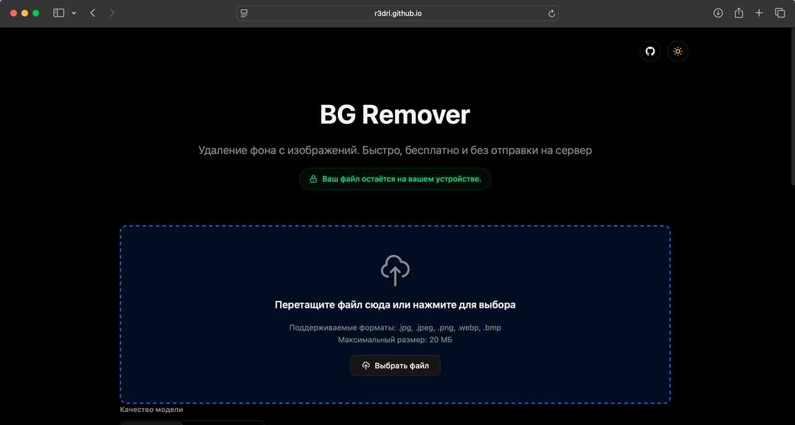

<div align="center">

# ️✂️ BG Remover

### Удаление фона с изображений нейросетью прямо в браузере

[](https://r3dri.github.io/bg-remover/)
[](LICENSE)
[](https://developer.mozilla.org/en-US/docs/Web/JavaScript)



**Ваш файл остаётся на вашем устройстве. Никаких серверов. Полная приватность.**

<div align="center">
  <a href="https://r3dri.github.io/bg-remover/" target="_blank">
    
  </a>
</div>

</div>

---

## 📖 О проекте

**BG Remover** — ощный локальный инструмент для удаления фона с изображений, который работает полностью в вашем браузере:
- 🧠 Нейросеть ONNX + WebAssembly анализирует изображение
- 🎯 Создаёт точную маску прозрачности
- 💾 Сохраняет результат без отправки на сервер

Всё работает **полностью в вашем браузере** — файлы никогда не покидают ваше устройство.

---

## Возможности

<table>
<tr>
<td width="50%">

### 🔒 Приватность
- 100% локальная обработка
- Никаких сетевых запросов
- Ваши данные в безопасности

</td>
<td width="50%">

### 🎨 Современный UI
- Тёмная и светлая темы
- Apple-like дизайн
- Плавные анимации

</td>
</tr>
<tr>
<td width="50%">

### 🤖 Нейросеть
- ONNX Runtime Web
- WebAssembly для скорости
- Два режима качества

</td>
<td width="50%">

### 📊 Статистика
- Время обработки
- Размер исходника и результата
- Разрешение изображения

</td>
</tr>
</table>

### Два режима качества

1. **Быстрая** — для простых задач с однотонным фоном и чёткими границами объекта
2. **Качественная** — для сложных случаев: волосы, прозрачные объекты, мелкие детали

---

## 🌍 Поддерживаемые форматы

<div align="center">
 Форматы изображений
[](#)
[](#)
[](#)
[](#)
[](#)
</div>


---

## Использование

### Онлайн (через GitHub Pages)

1. Перейдите на [демо-страницу](https://r3dri.github.io/bg-remover/)
2. Перетащите изображение в зону загрузки или нажмите "Выбрать файл"
3. Выберите качество модели (быстрая или качественная)
4. Дождитесь обработки нейросетью
5. Скопируйте результат или скачайте PNG

### Локально

```bash
# Клонируйте репозиторий
git clone https://github.com/r3dri/bg-remover.git

# Откройте index.html в браузере
cd bg-remover
open index.html  # macOS
# или
xdg-open index.html  # Linux
# или просто дважды кликните на файл